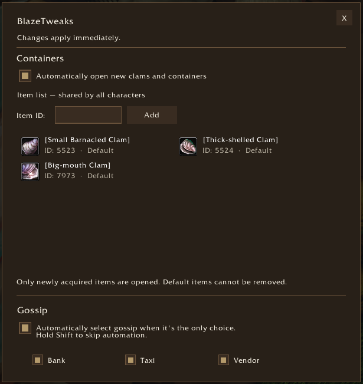

# BlazeTweaks

BlazeTweaks provides configurable container opening and NPC dialogue automation
for **World of Warcraft: Forever**. No other addons are required.

## Features

- Automatically open newly acquired clams and supported containers on your list.
- Add custom container item IDs to an account-wide list.
- Automatically select a single eligible Bank, Taxi, or Vendor dialogue option
  when no quests are offered.
- Hold Shift when talking to an NPC to choose manually.
- Enable the two tweaks independently for each character. Both default to off.

## Getting started

Download the named addon ZIP from [Releases](https://github.com/Blazeflack/BlazeTweaks/releases)
and extract the `BlazeTweaks/` folder into `Interface/AddOns`.
Previous releases are available in the [original repository](https://github.com/Blazeflack/WoW-AddOns/releases).

Open settings with `/bt` or `/blazetweaks` to enable the options you want and manage
the container list. Changes take effect immediately.

See [HOW_TO_USE.txt](HOW_TO_USE.txt) for the full guide.

## Compatibility and development

Designed for WoW Forever. Compatibility with other WoW versions is not guaranteed.
See [CHANGELOG.md](CHANGELOG.md) for changes and
[RELEASING.md](RELEASING.md) for release instructions.

## License

[MIT](LICENSE). Copyright (c) 2026 Blazeflack.
